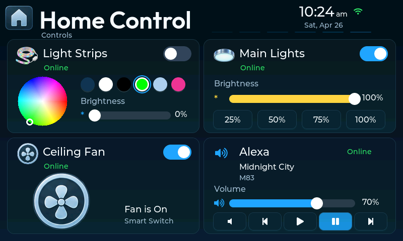
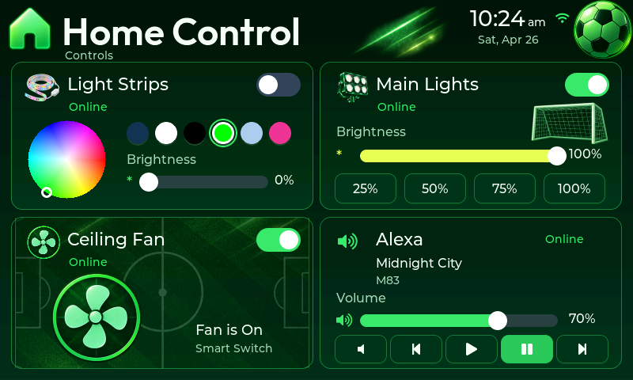
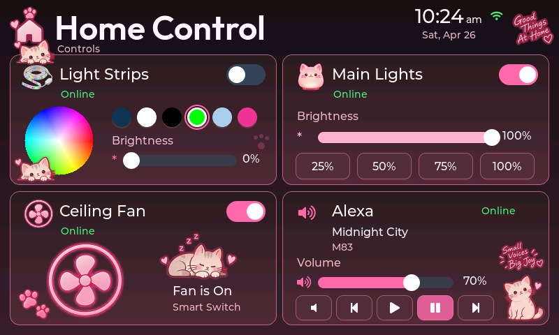
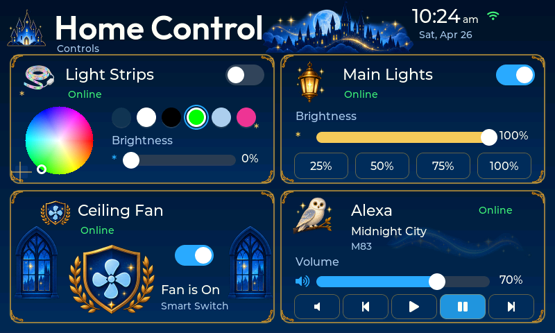
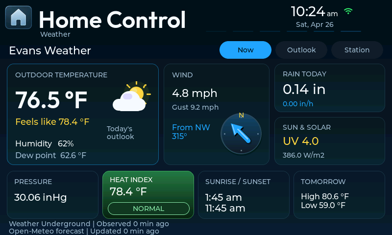
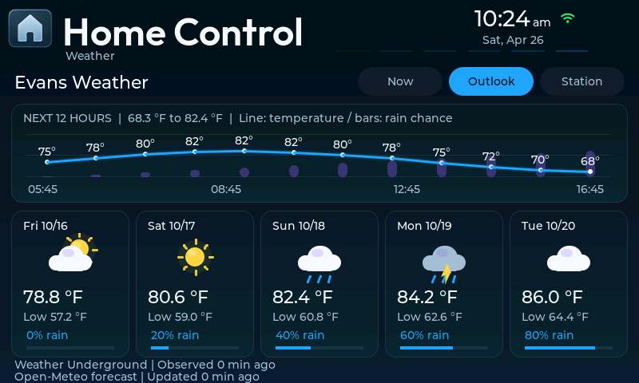
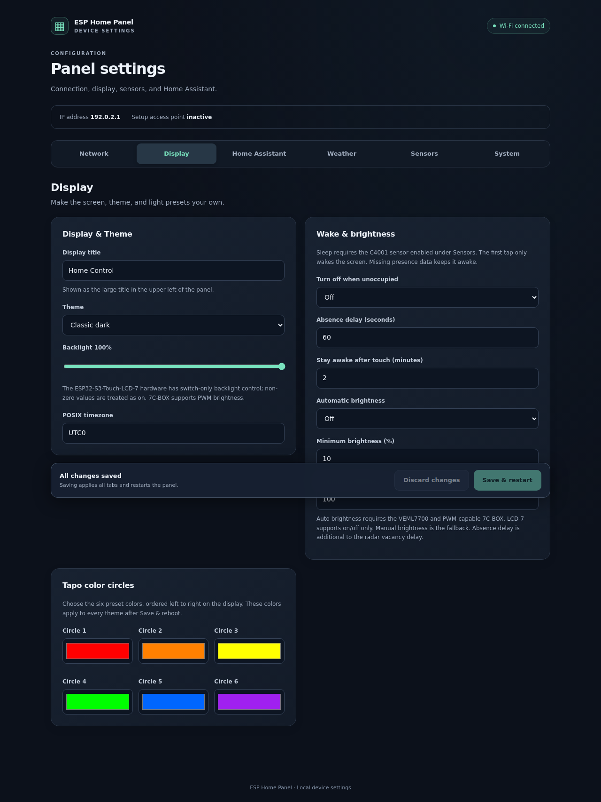
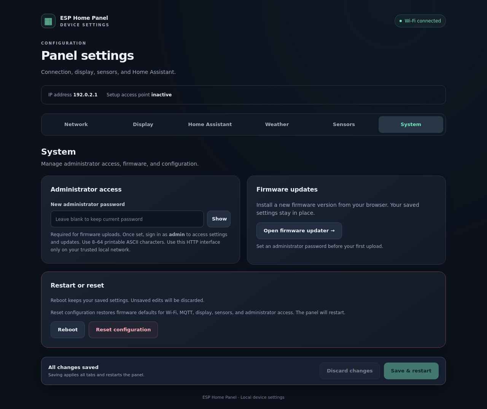

# ESP Home Panel

A themed, 7-inch touchscreen controller for Home Assistant, built with ESP-IDF and LVGL for Waveshare ESP32-S3 displays. Control lights, a ceiling fan and an Alexa-compatible media player; view local weather; and configure the panel from a browser.

[Getting started](#getting-started) · [Screenshots](#screenshots) · [Documentation](#documentation) · [License](#license)

## Features

- **Home controls:** light-strip brightness and color presets, main-light brightness, fan controls, and media playback, volume and track navigation. Setting a nonzero light brightness also turns the light on.
- **Four themes:** Classic, Soccer, Kittens and Magic, with a configurable title and clock.
- **Home Assistant over MQTT:** discovery, state synchronization and separate topic namespaces for multiple panels. The included bridge package maps panel commands to your existing entities.
- **Direct weather:** Ambient Weather or Weather Underground observations, optional Open-Meteo or Weather Underground forecasts, and Now, Outlook and Station views.
- **Optional sensors:** VEML7700 illuminance and Gravity C4001 SEN0610 occupancy, with MQTT discovery, presence wake and supported-hardware automatic brightness.
- **Browser administration:** six settings tabs, DHCP hostname/mDNS discovery, restart/reset controls and authenticated firmware uploads with startup rollback support.

This is standalone ESP-IDF firmware, not an ESPHome YAML configuration. Home Assistant performs device actions; the panel does not connect directly to Tapo or Alexa services.

## Screenshots

Captured from the production LVGL UI and web settings handler using host fixtures and sample data. These are software-rendered screenshots, not photographs of a physical panel.

| Classic | Soccer |
| --- | --- |
|  |  |
| **Kittens** | **Magic** |
|  |  |
| **Weather — Now** | **Weather — Outlook** |
|  |  |

<details>
<summary>Browser settings</summary>





</details>

See [screenshot generation](docs/screenshots/README.md) to reproduce these captures.

## Hardware

| Item | Support |
| --- | --- |
| Waveshare ESP32-S3-Touch-LCD-7C-BOX | 800 × 480 RGB display, GT911 touch, PWM backlight dimming |
| Original Waveshare ESP32-S3-Touch-LCD-7 | Detected by the board driver; backlight on/off only |
| VEML7700 | Optional ambient-light sensor, I²C address `0x10` |
| Gravity C4001 SEN0610 | Optional I²C presence sensor |

The supplied build profile targets an ESP32-S3 with 16 MB flash and PSRAM. Both supported display variants use the `waveshare-7c-box` environment; the firmware detects their hardware profile at startup. Other Waveshare revisions are not automatically interchangeable. Check the exact model and [sensor wiring](docs/sensors.md) before connecting accessories.

You will also need USB power and a data-capable cable for initial flashing, a 2.4 GHz Wi-Fi network, and Home Assistant with an MQTT broker for home controls. Weather and local display/sensor behavior work independently of the Home Assistant control bridge.

## Getting started

### 1. Build and flash over USB

Install Python and [PlatformIO Core](https://docs.platformio.org/en/latest/core/installation/index.html), then run:

```sh
git clone https://github.com/StealthCat/esp-home-panel.git
cd esp-home-panel
python -m pip install platformio==6.1.18
pio run -e waveshare-7c-box
pio run -e waveshare-7c-box -t upload
pio device monitor -b 115200
```

If more than one serial device is connected, add `--upload-port /dev/ttyACM0` to the upload command, replacing the port with your device (for example, `COM5` on Windows).

PlatformIO installs the pinned Espressif platform/toolchain and resolves the ESP-IDF components in [`main/idf_component.yml`](main/idf_component.yml). The first build requires internet access. Theme PNGs are packed automatically; normal builds do not require an image generator or font conversion.

Use a **full USB upload for the first installation** so the partition table and rollback-enabled bootloader are installed together. Keep USB available for recovery.

### 2. Connect and configure

1. On an unconfigured panel, join **`ESP-Home-Panel-XXXXXX`** using password **`configureme`**.
2. Open **http://192.168.4.1/** in your browser.
3. Under **Network**, enter Wi-Fi credentials and a unique hostname.
4. Under **Home Assistant**, enter the MQTT broker URI and credentials, choose a unique Panel ID, and enter your target entity IDs.
5. Under **Display**, choose a theme, title and POSIX timezone. Enable weather and sensors only when configured and available.
6. Under **System**, set an administrator password, then save and restart.
7. Reconnect to your normal network and open the panel's IP address or `http://<hostname>.local/`. Sign in as **`admin`** using the password you set.

The setup AP also provides a fallback when Wi-Fi cannot connect. The serial log reports the AP/network address. mDNS availability depends on your network; use the IP address when `.local` does not resolve.

The settings server uses **HTTP**, including Basic authentication. Keep it on a trusted local network and do not expose it directly to the internet. See [administrator access and recovery](docs/firmware-updates.md#administrator-access).

### 3. Install the Home Assistant bridge

MQTT discovery makes the panel visible, but the bridge package is required to control existing Home Assistant entities.

1. Configure Home Assistant's MQTT integration to use the same broker.
2. Copy [`home-assistant/esp_home_panel.yaml`](home-assistant/esp_home_panel.yaml) to `/config/packages/esp_home_panel.yaml`.
3. If packages are not already enabled, add the following to the existing `homeassistant:` section in `configuration.yaml` (do not create a duplicate section):

   ```yaml
   homeassistant:
     packages: !include_dir_named packages
   ```

4. Check the Home Assistant configuration, then restart or reload the affected YAML configuration.
5. Configure the panel's targets: `light.*` for lights, `fan.*` or `switch.*` for the fan, and `media_player.*` for Alexa/media. Available actions depend on the target integration.

Keep the filename **`esp_home_panel.yaml`**: `!include_dir_named` uses it as the package name. Install only one bridge copy for all panels using the same base topic.

| Setting | Default |
| --- | --- |
| MQTT runtime base topic | `home/7c-panel` |
| Per-panel topic root | `home/7c-panel/<panel-id>` |
| Home Assistant discovery prefix | `homeassistant` |

Keep the runtime base topic and discovery prefix separate. If you change the runtime base topic, update the bridge's MQTT triggers to match. See the [complete integration guide](home-assistant/README.md) for commands, state synchronization and multiple panels.

## Firmware updates

After the initial full USB flash, open **System → Firmware Update** and upload `.pio/build/waveshare-7c-box/firmware.bin`. An administrator password is required.

The [firmware workflow](https://github.com/StealthCat/esp-home-panel/actions/workflows/build-firmware.yml) also provides an `esp-home-panel-ota-<commit>` artifact after successful builds. Extract its application `firmware.bin`; do not upload the ZIP, bootloader, partition table or Wokwi/merged image.

Updates preserve saved settings. Partition-table or bootloader changes still require USB. Read the [update and recovery guide](docs/firmware-updates.md) for startup checks, rollback limits and on-device validation. When upgrading controls, update the Home Assistant bridge package alongside the firmware.

## Documentation

| Guide | Contents |
| --- | --- |
| [Home Assistant](home-assistant/README.md) | MQTT setup, entity mapping, multiple panels and protocol |
| [Web settings](docs/web-settings.md) | Settings tabs, saving, reboot and reset |
| [Weather and display](docs/weather-display.md) | Provider credentials, forecast views, sleep and automatic brightness |
| [Sensors](docs/sensors.md) | Wiring, supported models, configuration and MQTT discovery |
| [Network discovery](docs/network-hostname.md) | Hostnames, DHCP, mDNS and LAN DNS |
| [Firmware updates](docs/firmware-updates.md) | USB/OTA installation, authentication and recovery |
| [Display artwork](docs/display-artwork.md) | Theme assets and rendering |
| [Wokwi](wokwi/README.md) | Simulator setup and limitations |
| [Release checklist](docs/releasing.md) | Source, licensing, build and hardware verification |

## Development

Application code lives in `main/`, artwork in `assets/`, and host checks in `tools/` and `tests/host/`. Useful starting checks:

```sh
python tools/check_theme_assets.py
python tools/test_component_cmake.py
python tools/test_light_commands.py
python tools/test_weather.py
python tools/test_display_policy.py
```

Host C checks require a C compiler; LVGL rendering also needs CMake and the dependencies described in [screenshot generation](docs/screenshots/README.md). GitHub Actions runs the broader regression checks, browser checks, firmware build and UI rendering. Host fixtures do not replace testing touch, sensors, networking and OTA recovery on the actual hardware.

For bug reports, include your board model, firmware commit/build, reproduction steps and relevant serial output. Remove Wi-Fi/MQTT passwords, API keys and other private information before posting logs.

## License

Original project code and documentation are licensed under the **GNU General Public License v3.0 only** (`GPL-3.0-only`), unless a file states otherwise. See [LICENSE](LICENSE) for the full terms. Project-owned artwork is provided under the same terms to the extent copyright applies.

Third-party components and font assets retain their own licenses; in particular, Outfit and its generated font data remain under the SIL Open Font License 1.1. See [THIRD_PARTY_NOTICES.md](THIRD_PARTY_NOTICES.md). When distributing firmware, provide its corresponding source and retain the applicable license notices.
