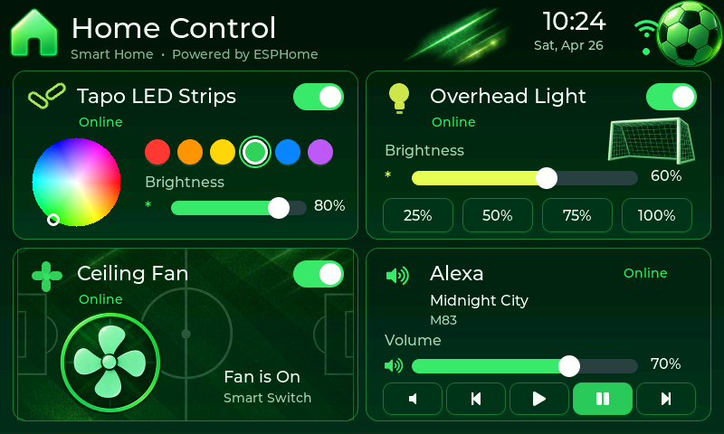
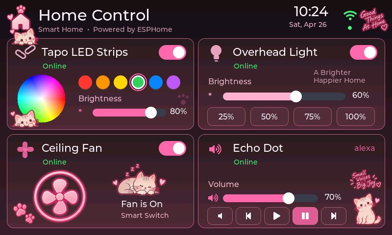
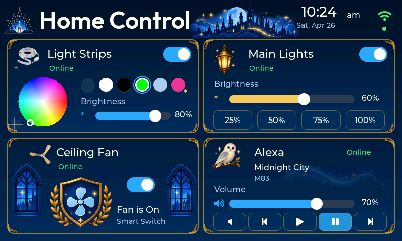
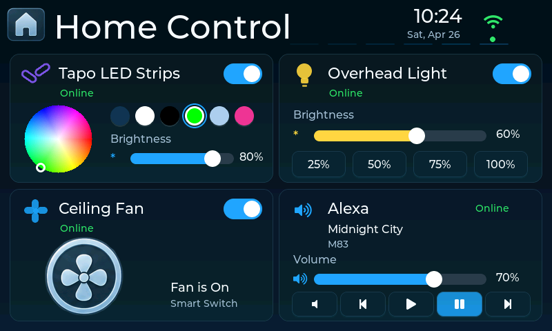

# Display artwork and visual verification

The 800×480 interface uses the supplied artwork with live LVGL switches,
sliders, buttons, titles, clock and state values. It is not a flattened mockup.

- Soccer: pitch behind the fan card, green home/ball/streak/goal and fan sprites.
- Kittens: home, peeking/sleeping/sitting cats, paws, captions and pink fan.
- Magic: castle, lantern, owl, windows, wand, wave, gold corners and fan crest.
- Classic: supplied blue home tile and fan badge.

The Alexa card displays the current media title and artist/author on two separate
scrolling lines in all themes. Its redundant corner wordmark is removed.

Alexa controls are Mute, Previous, Play, Pause and Next. Update the Home Assistant
MQTT package alongside firmware to enable track navigation.

Each sprite is fitted without stretching. Decoration stays inside its parent
bounds and cannot intercept touch events. The color wheel has an ARGB canvas,
so its corners blend with the theme. Status starts at Waiting, changes to Online
when an entity state arrives, and changes to Offline on MQTT disconnection.
Online indicates a received state, not an independently polled device heartbeat.

## Custom color circles

Open the panel's IP address in a browser and use **Tapo color circles** to choose
six colors, ordered left to right. Select **Save & reboot** to apply them. The
circles show the configured RGB colors and send those same values when tapped,
across all themes. Colors persist through power cycles and firmware upgrades
that retain NVS. Existing installations keep the original preset command colors
until edited; **Reset configuration** restores them along with all other settings.

## Actual LVGL renders

These are produced by compiling the production `main/ui.c` and `theme_art.c`
against the firmware's LVGL 9.5.0, with hardware and MQTT calls stubbed. The
screens show sample state and a fixed clock. They are not design mockups.






## Build and verify

Normal PlatformIO and native ESP-IDF builds pack the committed PNGs
automatically. Native CMake also watches the PNGs, manifest and packer, so an
asset edit triggers regeneration. For the first build after this cleanup, use
`pio run -t clean && pio run`, or `idf.py fullclean && idf.py build` in an existing
configured ESP-IDF environment. No filesystem/asset partition upload is needed:
the images are compiled into the application.

For a desktop check, install Python 3, CMake and a C/C++ compiler:

```sh
python tools/check_theme_assets.py
git clone --depth 1 --branch v9.5.0 https://github.com/lvgl/lvgl.git /tmp/panel-lvgl
cmake -S tests/host -B build/host -DLVGL_DIR=/tmp/panel-lvgl -DCMAKE_BUILD_TYPE=Debug
cmake --build build/host --parallel 4
mkdir -p build/previews
for theme in 0 1 2 3; do
  build/host/panel_render "$theme" "build/previews/theme-$theme.ppm"
done
```

The harness checks image descriptors, bounds, non-clickable decorations,
MQTT state application/disconnection, color preset commands, fan switching and
separate Echo Play/Pause commands and Previous/Next navigation. It renders the same RGB565 target/ARGB8888 source combination as
the device. GitHub Actions runs these checks and uploads all four PPM renders.
Desktop verification does not validate the ESP-IDF toolchain, LCD timing,
physical touch calibration or behavior on the Waveshare hardware.
