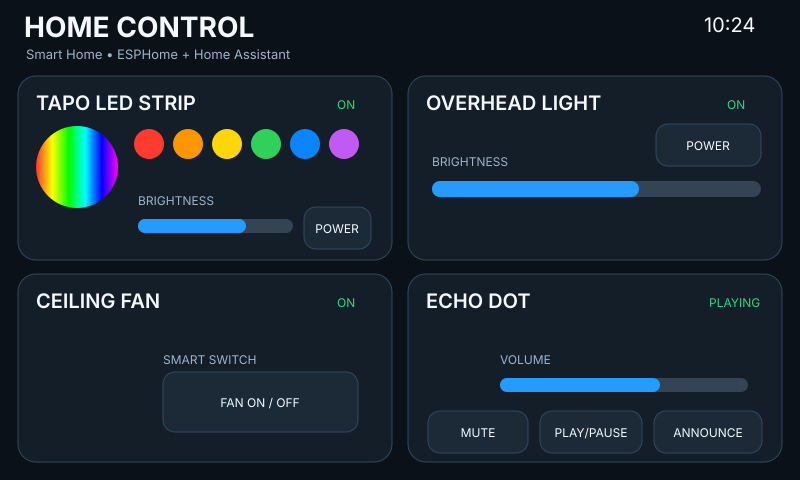

# Home Panel Classic

Original dark dashboard: graphite/navy cards with bright blue controls and restrained smart-home circuit artwork.




## Files

- `panel.yaml` — theme colors, entity IDs, shared LVGL package and image assets
- `assets/header-art.svg` — header artwork used by the live panel
- `assets/fan.svg` — themed ceiling-fan graphic used by the live panel
- `assets/echo.svg` — themed Echo/media graphic used by the live panel
- `preview.svg` — vector preview of the deployed screen geometry

## Setup

Edit these four substitutions in `panel.yaml` before compiling:

```yaml
tapo_led_entity: light.tapo_led_strip
overhead_light_entity: light.overhead_light
ceiling_fan_entity: switch.ceiling_fan
echo_dot_entity: media_player.echo_dot
```

Then validate/install from the repository root:

```bash
esphome config panels/classic-dark/panel.yaml
esphome run panels/classic-dark/panel.yaml
```

The **Announce** button fires `esphome.panel_echo_announce` with `entity_id` and `panel` event data. Use a Home Assistant automation to route that event to the Alexa/Echo notify mechanism you prefer.
