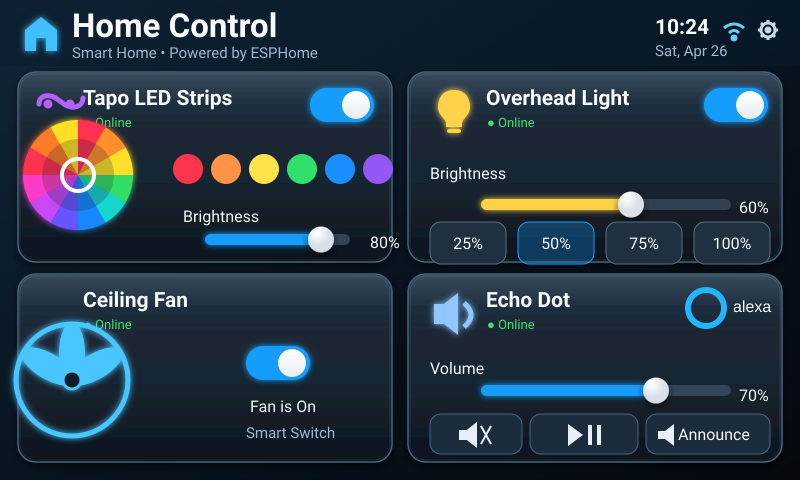

# Home Panel Classic

Mockup-faithful graphite/navy dashboard with glossy beveled cards, blue illuminated controls, a full color wheel, and the same four-card composition as the original concept render.



## Files

- `panel.yaml` — ESPHome entry point, entity substitutions and shared packages
- `assets/screen.svg` — the complete 800×480 visible surface used by the live panel
- `../../shared/ui-dashboard.yaml` — transparent LVGL touch/slider regions aligned to the artwork
- `../../shared/home-assistant-controls.yaml` — Home Assistant state bridge for the hidden interactive controls

The artwork-first approach is intentional: bevels, shadows, gradients, iconography and decorative details are rasterized by ESPHome into one RGB565 image, while LVGL is used as an invisible interaction layer above it. This avoids reducing the mockup to flat LVGL rectangles.

## Setup

Edit these four substitutions in `panel.yaml` before compiling:

```yaml
tapo_led_entity: light.tapo_led_strip
overhead_light_entity: light.overhead_light
ceiling_fan_entity: switch.ceiling_fan
echo_dot_entity: media_player.echo_dot
```

Then validate/install from the repository root:

```bash
esphome config panels/classic-dark/panel.yaml
esphome run panels/classic-dark/panel.yaml
```

The **Announce** control fires `esphome.panel_echo_announce` with `entity_id` and `panel` event data. Route that event to your preferred Alexa/Echo notify automation in Home Assistant.
