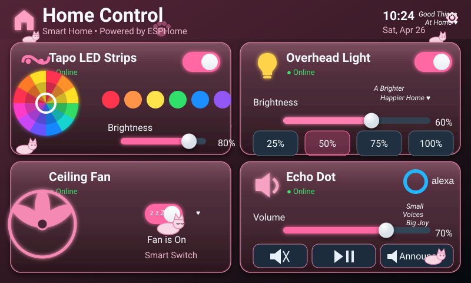

# Home Panel Kittens

Pink kitten-themed version of the dashboard, rebuilt to closely match the mockup with rosy glass bevels, paw-print details, peeking and sleeping kitten artwork, hearts, handwritten decorative phrases, and the same four-card control layout.



## Files

- `panel.yaml` — ESPHome entry point and Home Assistant entity substitutions
- `assets/screen.svg` — complete 800×480 deployed artwork
- `../../shared/ui-dashboard.yaml` — transparent interaction layer aligned to the artwork
- `../../shared/home-assistant-controls.yaml` — Home Assistant state bridge

The kitten illustrations and decorative effects are part of the live screen artwork rather than separate decorative widgets, so they retain their intended placement and appearance on the 800×480 panel.

## Setup

Edit the four Home Assistant entity IDs in `panel.yaml`, then run:

```bash
esphome config panels/kittens-pink/panel.yaml
esphome run panels/kittens-pink/panel.yaml
```

The **Announce** control fires the `esphome.panel_echo_announce` Home Assistant event.
