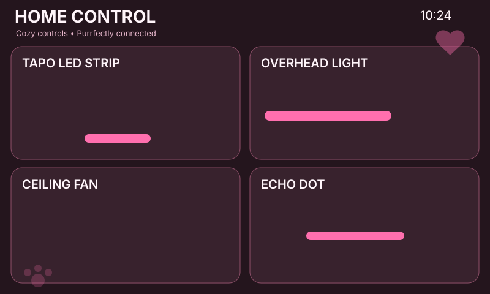

# Home Panel Kittens

Rose/pink kitten theme: cat/paw/heart artwork, warm dark-plum cards and pink controls.

## Files

- `panel.yaml` — theme colors, entity IDs, shared LVGL package and image assets
- `assets/header-art.svg` — header artwork used by the live panel
- `assets/fan.svg` — themed ceiling-fan graphic used by the live panel
- `assets/echo.svg` — themed Echo/media graphic used by the live panel
- `preview.svg` — vector preview of the deployed screen geometry

## Setup

Edit these four substitutions in `panel.yaml` before compiling, then run `esphome config panels/kittens-pink/panel.yaml` and `esphome run panels/kittens-pink/panel.yaml` from the repository root.

The **Announce** button fires `esphome.panel_echo_announce` with `entity_id` and `panel` event data. Use a Home Assistant automation to route that event to the Alexa/Echo notify mechanism you prefer.
