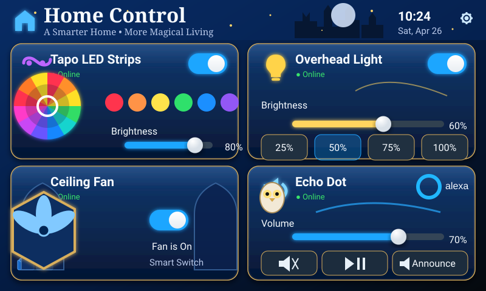

# Home Panel Magic Bricks

Deep-blue magical-school/building-brick theme closely matching the mockup: moonlit castle skyline, stars, gold ornamental card borders, gothic window details, owl artwork, blue brick accents, and warm lantern-style lighting cues.



The visual language is an original generic enchanted-school/building-brick aesthetic; it does not use third-party franchise logos or character artwork.

## Files

- `panel.yaml` — ESPHome entry point and Home Assistant entity substitutions
- `assets/screen.svg` — complete 800×480 deployed artwork
- `../../shared/ui-dashboard.yaml` — transparent interaction layer aligned to the artwork
- `../../shared/home-assistant-controls.yaml` — Home Assistant state bridge

The full-screen artwork supplies the ornate gold trim, stars, castle, owl, windows and brick graphics. Transparent LVGL controls preserve touch interaction without flattening the visual design.

## Setup

Edit the four Home Assistant entity IDs in `panel.yaml`, then run:

```bash
esphome config panels/magic-bricks-blue/panel.yaml
esphome run panels/magic-bricks-blue/panel.yaml
```

The **Announce** control fires the `esphome.panel_echo_announce` Home Assistant event.
