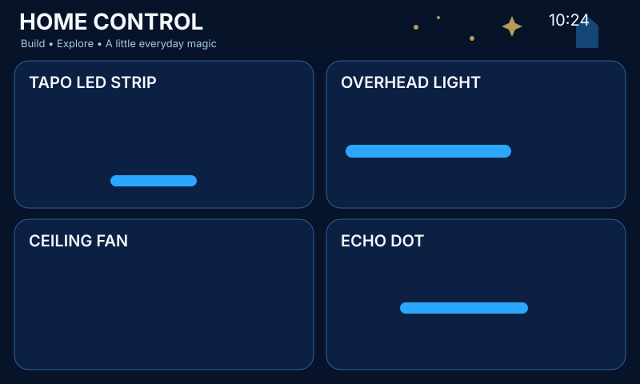

# Home Panel Magic

Blue magical-school/building-brick theme: original castle/stars/building-block artwork with blue and gold accents; no franchise logos or character art.

## Files

- `panel.yaml` — theme colors, entity IDs, shared LVGL package and image assets
- `assets/header-art.svg` — header artwork used by the live panel
- `assets/fan.svg` — themed ceiling-fan graphic used by the live panel
- `assets/echo.svg` — themed Echo/media graphic used by the live panel
- `preview.svg` — vector preview of the deployed screen geometry

## Setup

Edit the four Home Assistant entity substitutions in `panel.yaml`, then validate/install with `esphome config panels/magic-bricks-blue/panel.yaml` and `esphome run panels/magic-bricks-blue/panel.yaml`.

The **Announce** button fires `esphome.panel_echo_announce` with `entity_id` and `panel` event data. Use a Home Assistant automation to route that event to the Alexa/Echo notify mechanism you prefer.
