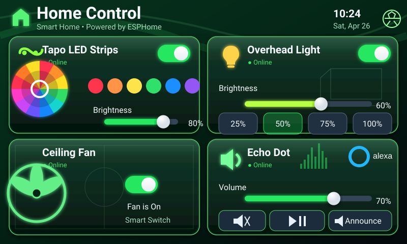

# Home Panel Soccer

Green soccer-themed version of the original dashboard, rebuilt to match the mockup with illuminated green bevels, field markings, goal/net art, a soccer-ball header accent, and an audio equalizer treatment for the Echo card.



## Files

- `panel.yaml` — ESPHome entry point and Home Assistant entity substitutions
- `assets/screen.svg` — complete 800×480 deployed artwork
- `../../shared/ui-dashboard.yaml` — transparent interaction layer aligned to the visible controls
- `../../shared/home-assistant-controls.yaml` — Home Assistant state bridge

The visible interface is one full-resolution RGB565 image at runtime. LVGL buttons and sliders are transparent and sit directly over the toggles, color presets, brightness controls, fan switch, and Echo controls shown in the artwork.

## Setup

Edit the four Home Assistant entity IDs in `panel.yaml`, then run:

```bash
esphome config panels/soccer-green/panel.yaml
esphome run panels/soccer-green/panel.yaml
```

The **Announce** control fires the `esphome.panel_echo_announce` Home Assistant event.
